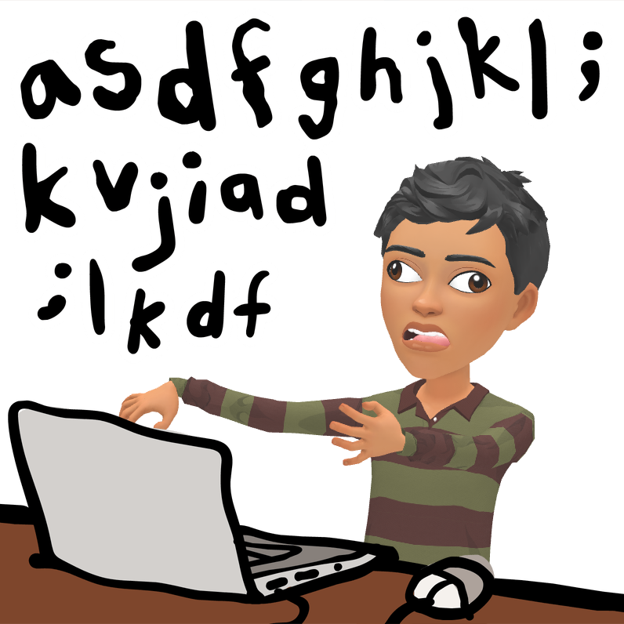
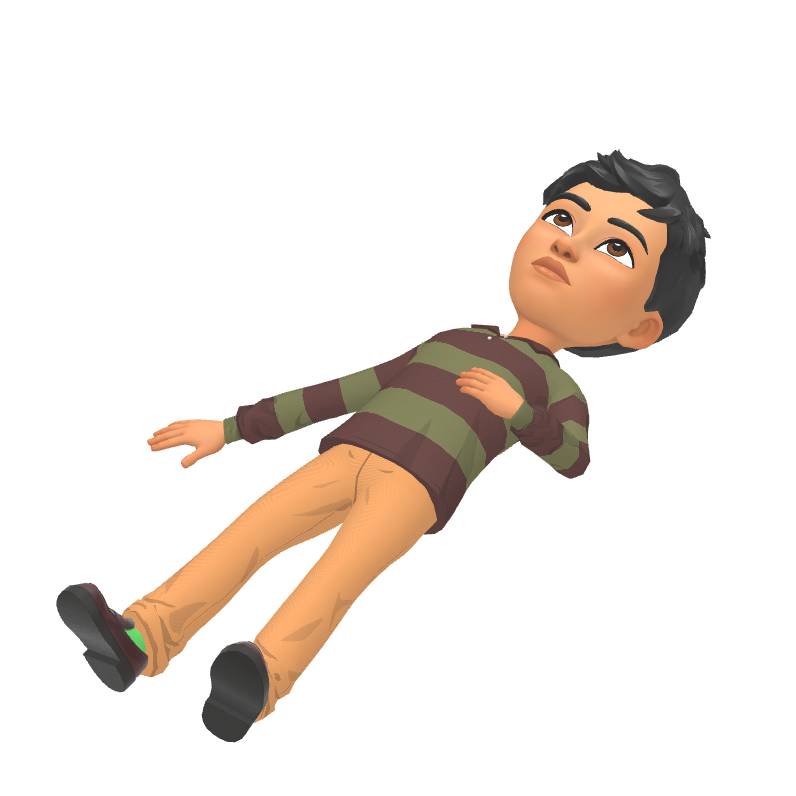

  

## about

  i'm curiosity-driven person feel ambitious for work on OSS and personal projects on my leisure time. learning new concepts day-to-day helping my collegues to get better at statistics and programming through short content, want to share my tryings of learning online and contribute with awesome ppl. open to contribute. 👐

## skills

  

  

